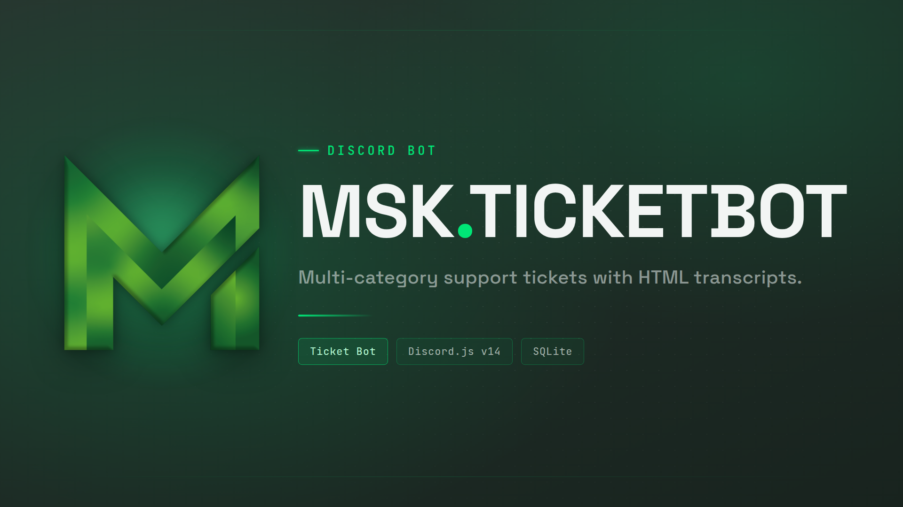

<div align="center">

# 🎫 Discord Ticket Bot

[](https://github.com/MSK-Scripts/discord_ticketbot/releases)
[](LICENSE.md)
[](https://nodejs.org)
[](https://discord.js.org)
[](https://github.com/MSK-Scripts/discord_ticketbot/pkgs/container/discord_ticketbot)
[](https://docu.msk-scripts.de/discord/discord_ticketbot/getting-started/)

**Self-hosted Discord ticket bot with HTML transcripts, a web dashboard and 7 languages.**

English · [Deutsch](README_GER.md) · [Website](https://www.msk-scripts.de/ticketbot)

</div>

A complete ticket system for your Discord server: ticket types with their own staff and questions, claiming, priorities, locking, auto-close, ratings, canned responses and self-contained HTML transcripts. It is a plain Discord bot built on Discord.js v14. All it needs is Node.js or Docker and a bot token; no game server, no framework, no telemetry.

Data stays with you in a local SQLite file, or in your own MySQL, MariaDB or PostgreSQL database. An optional web dashboard lets your team handle tickets, edit the configuration and control the bot in the browser. Hosted transcript links and fully hosted bots are available through the optional [MSK transcript service](docs/setup-en.md).

## Quick start

```bash
mkdir -p ticketbot/config ticketbot/data && cd ticketbot
sudo chown -R 1000:1000 config data
curl -O https://raw.githubusercontent.com/MSK-Scripts/discord_ticketbot/main/docker-compose.yml
# create .env with TOKEN, CLIENT_ID and GUILD_ID, then:
docker compose up -d
```

The first start writes `config/config.jsonc` and lists every placeholder you still have to fill in. Restart, then run `/setup` on your server to post the ticket panel. Without Docker: `npm install`, copy `.env.example` and `config/config.example.jsonc`, `npm start`. Details in [Installation](docs/installation-en.md).

## Documentation

| Topic | Where |
|---|---|
| Features, slash commands and buttons | [docs/features-en.md](docs/features-en.md) |
| Installation, database, systemd, updating | [docs/installation-en.md](docs/installation-en.md) |
| Configuration reference | [docs/configuration-en.md](docs/configuration-en.md) |
| Web dashboard | [docs/dashboard-en.md](docs/dashboard-en.md) |
| Transcript service, tiers, custom domain, hosted bots | [docs/setup-en.md](docs/setup-en.md) |
| Project layout and database schema | [docs/development-en.md](docs/development-en.md) |
| Changes per version | [CHANGELOG.md](CHANGELOG.md) |
| Full guide with screenshots | [docu.msk-scripts.de](https://docu.msk-scripts.de/discord/discord_ticketbot/getting-started/) |

## Help and contributing

- Questions and support: [Discord](https://discord.gg/5hHSBRHvJE)
- Bugs and feature requests: [GitHub Issues](https://github.com/MSK-Scripts/discord_ticketbot/issues)
- Security issues, please report privately: [SECURITY.md](SECURITY.md)
- Pull requests and new languages are welcome: [CONTRIBUTING.md](CONTRIBUTING.md) and the [Code of Conduct](CODE_OF_CONDUCT.md)

## License

AGPL-3.0-only, see [LICENSE.md](LICENSE.md). Anyone who distributes or hosts a modified version must publish its source under the same license.

One additional term under Section 7(b): the notice identifying the software as MSK Ticket Bot has to stay visible to the people using the bot. Servers with an active Premium or Premium+ subscription are exempt. The exact wording is in [NOTICE](NOTICE).
